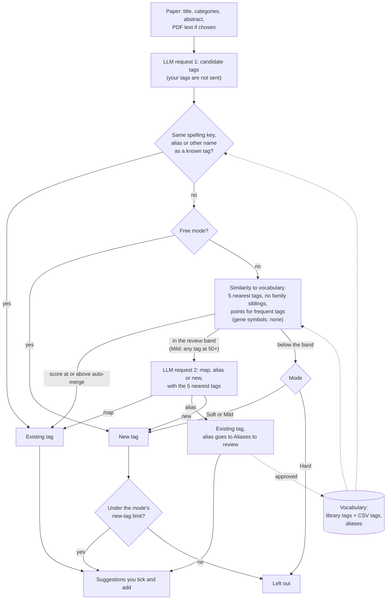

# AI tags

AI tags suggests tags for a paper and checks each one against the tags your library already has. The aim is one tag per concept: `RNA-seq`, `RNAseq` and `RNA sequencing` should all end up as the same tag.

You can ask for tags in three places:

- **AI Tags** on the paper page;
- **AI tags** in the Library batch panel, for the papers you tick;
- the [bulk AI tags script](bulk-ai-tags.md) on the server, for the whole library.

AI features must be on ([AI features](ai.md)). Suggestions are only a preview. Nothing is added until you tick the tags and click **Add**, or the bulk script adds them.

## How a suggestion is made

The model is asked twice at most. The first request reads the paper and suggests tags. The server matches those against your vocabulary without the model. Only the suggestions it can't place go back to the model in a second, short request.



### Step 1: candidate tags

The first request sends:

- the title and categories;
- the abstract, up to 6,000 characters;
- the paper's current tags, so the model doesn't repeat them;
- with PDF text on, the text of the first 5 pages of the saved PDF. A paper without a readable PDF falls back to the abstract.

Your existing tags are not sent. The model suggests what the paper is about, and the matching steps below decide whether that is a tag you already have.

The system prompt is:

```{ .text .wrap }
You tag research papers in a personal library. Suggest 3 to 6 short topical tags for the paper, one tag per concept: never two tags that mean the same thing (not both 'microRNA' and 'miRNA').
Spell each tag in its normalized form: lowercase except acronyms and gene or protein symbols, singular nouns except fixed plural terms such as 'systems biology' or 'social sciences', American spelling ('signaling', 'tumor'), one to three words, hyphens only where the term uses them ('RNA-seq'), no '#'. Keep standard acronyms as written (DNA, RNA-seq, CRISPR, MRI); write rare abbreviations out in full. Put abbreviations and other common names of the same tag in also_known_as. Do not repeat the paper's current tags.
```

The model replies with a list of tags, each with its other names:

```json
{"tags": [
  {"tag": "single-cell RNA-seq", "also_known_as": ["scRNA-seq"]},
  {"tag": "drug response", "also_known_as": []}
]}
```

At most 6 suggestions are kept. A tag longer than 64 characters is dropped. Some local models write every tag as a slug; a new tag with two or more hyphens and no spaces is stored with spaces (`fiber-optic-sensors` becomes `fiber optic sensors`). A tag with one hyphen, such as `RNA-seq`, keeps it. A few terms the field writes in the plural get that spelling back when they are new tags: `system biology` is stored as `systems biology`, and the same goes for `social sciences`, `life sciences`, `materials science` and the others in the server's list.

### Step 2: same tag in another spelling

Each candidate gets a spelling key. Two tags with the same key are the same tag. The key ignores:

- case, hyphens, underscores, slashes and punctuation;
- plural endings on each word (`neural networks` = `neural network`), except words ending in `ss`, `us`, `is` or `ics` (`analysis`, `genomics`). The key only decides what matches: `systems biology` and `system biology` are one tag, spelled the way your library has it;
- British spelling: `signalling`, `tumour`, `haematopoiesis` and `-isation` match `signaling`, `tumor`, `hematopoiesis` and `-ization`;
- `sequencing` against `seq`, so `RNA sequencing` = `RNA-seq`.

The candidate is looked up by its key among your tags, then in the alias table, then by the keys of its `also_known_as` names. A hit becomes your existing tag, spelled the way your library spells it. When the library has two spellings with the same key, the one on more papers is used.

### Step 3: close tags

A candidate with no match is compared with every tag in the vocabulary by string similarity, scored 0 to 100. The 5 nearest tags scoring at least 50 are kept.

Tags that differ only in a trailing number, letter or Greek letter are different members of one family, such as `STAT1` and `STAT5`, `IL6` and `IL10`, `FOXA1` and `FOXC1`, or `PPARalpha` and `PPARgamma`. They are never treated as close, however similar they look. `GSK3` and `GSK3B` count as forms of the same gene and can match.

Short gene symbols skip this step and only match by key or alias, because short strings look similar to many unrelated tags. That covers one-word tags of up to 6 characters with a digit or a capital letter, and any tag of 3 characters or fewer (`En1`, `NONO`).

Tags on more papers get extra points, set by **Preference for frequent tags** (default 10). The tag on the most papers gets the full amount, and rarer tags get less, on a log scale. The points are only added when the similarity has already reached the mode's review band, so they decide between plausible matches and can't pull in an unrelated tag.

For example, with the default 10 points and Soft mode (auto-merge at 95): a candidate is 90% similar to two tags, one on 100 papers (the most in the library) and one on 1 paper. The first scores 100 and the second about 91.5. The candidate merges into the tag on 100 papers.

### Step 4: second request

Candidates in the mode's review band go to a second request, all of them in one request per paper. It sends the paper title and, for each candidate, its 5 nearest tags with their paper counts:

```json
{"paper_title": "Deep CNNs",
 "candidates": [
   {"candidate": "convolution net",
    "neighbours": [{"tag": "convolutional network", "papers": 12},
                   {"tag": "neural networks", "papers": 40}]}
 ]}
```

The system prompt is:

```{ .text .wrap }
You keep the tag vocabulary of a research library consistent. For each candidate tag you get the existing tags closest to it and how many papers use each. Decide:
- map: the candidate means the same as one of those tags for this paper; tag = that tag, spelled exactly as listed.
- alias: the candidate is exactly the same concept as one of those tags under another name (an abbreviation, a spelling variant or a true synonym), so it should always become that tag; tag = that tag, spelled exactly as listed. Never use alias for a broader, narrower or related tag ('causal inference' is not an alias of 'statistical inference'); use map or new for those.
- new: none of them means the same (broader, narrower, related or a different member of a family such as STAT1 vs STAT5 is not the same); tag = the candidate with its spelling normalized.
Prefer an existing tag used by more papers when two fit equally. Answer every candidate.
```

The model answers each candidate with one of:

- `map`: use that existing tag for this paper only;
- `alias`: use that existing tag, and propose the candidate as its alias in **Aliases to review**;
- `new`: keep the candidate as a new tag, with the spelling the model corrected.

The server checks the answer. A map or alias to a tag that wasn't in the candidate's list of 5, or to a family member of the candidate, is treated as new. If the model skips a candidate, Soft keeps it as a new tag, while Mild and Hard leave it out.

If the corrected spelling of a new tag matches a tag you have, that tag is used.

Both requests also carry a JSON Schema and an example reply. Settings → AI shows them as **Tag suggestions: candidates** and **Tag suggestions: match to existing tags**.

### What you see

Each suggestion is a chip you can tick or untick:

- `RNA-seq ← RNA sequencing`: the model wrote `RNA sequencing`, and it was matched to your tag `RNA-seq`;
- `new`: the tag is in neither your library nor the vocabulary CSV;
- `alias?`: the model called its wording an alias of this tag, and the alias waits for review.

Hovering a chip says where the tag comes from and how it was matched. Candidates the mode left out are listed under the chips with the reason:

| Reason | Meaning |
|---|---|
| `no close tag` | Hard mode: no tag in the vocabulary is close enough |
| `no decision` | Mild or Hard: the second request gave no answer for it |
| `new-tag limit` | The paper already has as many new tags as **New tags per paper** allows |
| `new tags not allowed` | Hard mode, or **New tags per paper** is 0 |

## Modes

The mode decides how readily a candidate merges into an existing tag and how many new tags a paper can get.

| Mode | Merges by similarity at | Second request for | New tags per paper |
|---|---|---|---|
| Free | never (spelling key and aliases only) | nobody | up to 6 |
| Soft (default) | 95 | similarity 85 to 95 | up to 4 |
| Mild | 90 | every unmerged candidate with a tag at 50 or more | up to 2 |
| Hard | 85 | similarity 60 to 85 | none |

Free takes the model's tags as they are, apart from spelling variants and aliases. Use it on a new library, or to see what the model would suggest on its own.

Soft merges near-identical tags, asks the model about close ones and keeps the rest as new tags. It suits a library that is still growing.

Mild sends almost every unmatched candidate to the second request, and a candidate only becomes a new tag when the model says so. A candidate with no tag at 50 or more similarity becomes new without asking. Use it once the vocabulary covers most of what you read.

Hard never adds a new tag. Every suggestion is an existing tag or is left out. Use it with a closed vocabulary, for example one imported from a CSV.

## Options

All options are in **Settings → Tag vocabulary**, under **AI tag suggestions**, and are saved per library.

### Mode

Default Soft. Sets the mode above for every AI tag request: the paper page, the Library batch panel and the bulk script. Each of those can use another mode for one run (see [Choosing per run](#choosing-per-run)).

### New tags per paper

Default -1, which uses the mode's own limit (Free 6, Soft 4, Mild 2, Hard 0). A number from 0 to 6 replaces that limit in every mode except Hard, which always allows 0. Set 1 to let each paper add one new tag at most; set 0 to allow only existing tags while keeping the matching of your mode.

### Preference for frequent tags

Default 10, range 0 to 30. Points added to the similarity of a close tag, in full for the tag on the most papers and less for rarer tags. Raise it to steer suggestions toward the tags you use most; set 0 to compare by spelling similarity alone. A CSV `weight` replaces the paper count of its tag (see [Vocabulary CSV](#vocabulary-csv)).

### Read the saved PDF's text too

Default off. Sends the text of the first 5 pages of the saved PDF with the abstract. Those pages hold the introduction and methods of most papers, so tags can name methods and data the abstract leaves out, while references and supplementary pages stay out of the request. Each request is still longer than with the abstract alone, which matters most with a local model. Papers without a saved PDF use the abstract.

### Choosing per run

The paper page (next to **AI Tags**) and the Library batch panel (next to **Suggest tags**) have two selects:

- **Saved mode**, **Free**, **Soft**, **Mild** or **Hard**;
- **Saved text source**, **Abstract only** or **Abstract + PDF text**.

"Saved" uses the setting above. The bulk script has `--mode` and `--pdf` for the same purpose ([Bulk AI tags](bulk-ai-tags.md)).

## Aliases

An alias points one name at a tag: `NN` at `neural network`, `RNAseq` at `RNA-seq`. Aliases are checked right after the spelling key, before any similarity, so a merge decided once applies to every later paper without asking the model.

Aliases come from three places:

- The second request proposes one when it answers `alias`. The suggestion already uses the existing tag, and the alias waits in **Aliases to review**. **Approve** stores it, and it applies from the next suggestion on. **Reject** drops it, and the same alias is never proposed again.
- You add one by hand in **Aliases** (the alias, then the tag it stands for), where you can also delete them. With more than 10 aliases a filter box appears; the list shows the first 200 matches.
- A vocabulary CSV brings them in its `aliases` column, or as the old spellings of a tag map.

An alias and its tag can't have the same spelling key, since the key already matches them, and neither can be `reading-list`.

## Vocabulary CSV

The vocabulary is what AI tagging matches against: every tag in your library plus the tags of an imported CSV. A CSV tag that no paper has yet can still be suggested; it is added to linXiv when you add it to a paper. Import it in **Settings → Tag vocabulary → Vocabulary CSV**.

Two layouts are read, chosen by the header.

A tag list, with `tag` and optional `aliases` (separated by `|`) and `weight` columns:

```csv
tag,aliases,weight
RNA-seq,RNA sequencing|bulk RNA-seq,40
organoid,,
```

`weight` (0 or more) is used instead of the paper count when frequent tags get extra points. Use it to favour tags you plan to use even if few papers carry them yet.

A tag map from a tag consolidation, with `old_tag,new_tag,cluster,papers`:

```csv
old_tag,new_tag,cluster,papers
wnt pathway,wnt signaling,4,3
wnt signalling,wnt signaling,4,2
wnt signaling,wnt signaling,4,10
```

Each `new_tag` becomes a vocabulary tag, weighted by the sum of its `papers`. Each `old_tag` with a different spelling key becomes an alias of it; `wnt signalling` already shares its key, so it needs none. `cluster` is not used. An `old_tag` that is a family member of its `new_tag`, such as `STAT5` in a `stat3` cluster, is not imported as an alias, because clustering by name similarity puts family members together. The import result says how many it skipped.

Import rules:

- up to 50,000 rows; tags longer than 64 characters, empty tags, `reading-list` and bad weights are skipped and listed in the result (first 50);
- **Replace the CSV vocabulary and CSV aliases** removes the earlier CSV tags and CSV aliases first; aliases you added or approved stay. Without it the file is merged into what is there;
- an alias already stored is not overwritten.

**Download CSV** exports the CSV tags and every alias in the `tag,aliases,weight` layout, so the file can be edited and imported again.

## Once your tag library is stable

AI tagging works best on a vocabulary that is already consolidated. A routine that keeps it that way:

1. Consolidate the tags you have. Export them with [`export-tags.sh`](export-tags.md), merge variants and synonyms outside linXiv-web, and write the result back with [`import-tags.sh`](import-tags.md). Then run [Clean tags without papers](server-admin/maintenance.md) in Settings → Server Admin → Maintenance operations.
2. Import the consolidation's tag map as the vocabulary CSV. Every old spelling becomes an alias, so a model that suggests one gets the consolidated tag instead.
3. Switch the mode to **Mild**, or to **Hard** if new papers should only get tags you already have. Lower **New tags per paper** to 1 or 2 if Mild still adds too many.
4. Look at **Aliases to review** from time to time. Approve real synonyms; reject broader or narrower terms.
5. When you start reading in a new field, use **Soft** or **Free** for those papers, from the paper page or the batch panel, so the new topics get tags.
6. Export the tags again now and then, to see how fast the vocabulary grows and whether it needs another consolidation.

## Storage

The vocabulary CSV, aliases and aliases to review are stored per library in `linxiv-web-tags.db`, next to `papers.db`. linXiv itself doesn't read this file. The [Back up databases](server-admin/maintenance.md) maintenance operation copies it as `tags-<date>-<time>.db` next to each database backup. The HTTP routes are listed in the [API reference](reference/api.md).

<!-- cspell:words Aseq vocab signaling tumor CRISPR fiber isation hematopoiesis ization FOXC Ralpha Rgamma NONO -->
