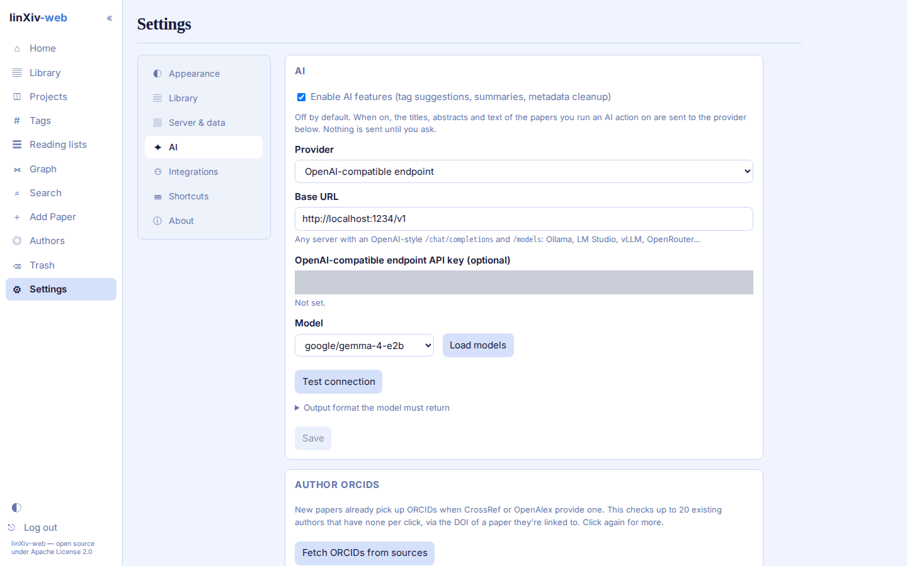

# AI features

AI features are off by default. To turn them on, open **Settings → AI**, tick the switch, and pick a provider: Gemini, OpenAI, Anthropic, or an OpenAI-compatible base URL such as `http://localhost:1234/v1` for LM Studio. Paste a key (local servers may not need one), Save, then click **Load models**, pick one, Save again and click **Test connection**.

| Action | Where | What the model gets | Result |
|---|---|---|---|
| AI Tags | paper page, Library batch panel ("AI tags") | title, categories, abstract, current tags, your existing tag vocabulary | up to 8 tags to tick and add |
| AI summary | paper page | "Abstract only", or "Abstract + PDF text" (first 40 pages, 60k characters) | summary + key points, saved as a note on request |
| AI cleanup | Edit metadata and Library batch metadata, source "AI cleanup" | title, authors, journal | a candidate shown as a field diff; nothing is saved until you approve |

Nothing is sent to the provider until you click an AI button, and AI actions only return previews. You decide what gets saved.

## How requests are made

Every request carries a JSON Schema and a valid example reply; Settings → AI shows both. OpenAI and OpenAI-compatible servers get structured output (`response_format: json_schema`), which also stops "thinking" models such as Qwen from spending the whole token budget on reasoning. A server that rejects structured output is retried with the schema in the prompt only. Anthropic uses a forced tool call.

Requests time out after 90 s, or 300 s for OpenAI-compatible servers, since local models read long prompts slowly.

`LINXIV_WEB_AI_ALLOWED_HOSTS` limits which hosts the OpenAI-compatible base URL may use. Cloud metadata addresses are always refused. See [Configuration](reference/configuration.md).

## Tagging the whole library

To tag every untagged paper in one run, use the [bulk AI tags script](bulk-ai-tags.md) on the server.
