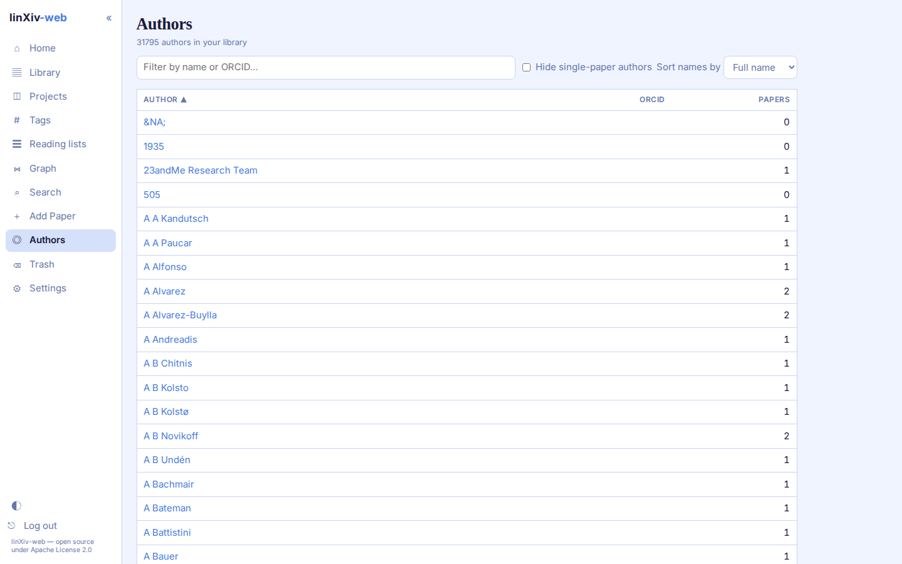
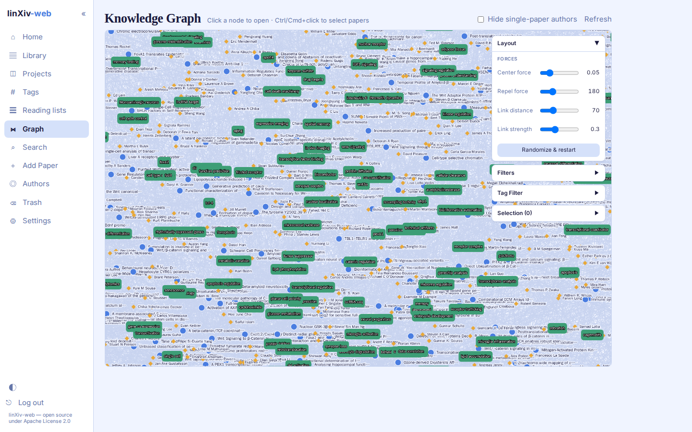
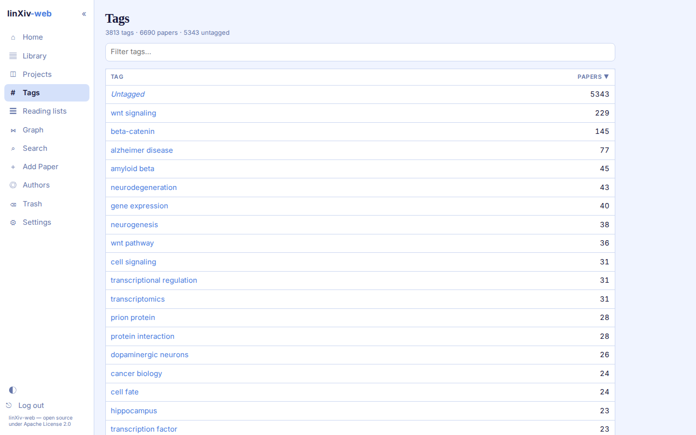

# Authors, graph and tags

## Authors

The Authors page lists every author in the library with their ORCID and paper count. Filter by name or ORCID, hide authors with a single paper, and sort by full name or last name.

An author page shows their papers. From there you can edit the full, first and last name and the ORCID, or merge the author with a duplicate. linXiv-web suggests merge candidates, including authors with the same name.

**Settings → AI → Author ORCIDs** fills in missing ORCIDs from Crossref and OpenAlex, 20 authors per click.

## Knowledge graph

The graph shows papers, authors and tags as nodes. Click a node to open it, and <kbd>Ctrl</kbd>/<kbd>Cmd</kbd>+click to select papers. The side panels adjust the layout forces and filter the graph by node type (papers, authors, tags), category, PDF, date range or tag.

With thousands of papers the graph gets dense. Tick **Hide single-paper authors** or use the tag filter to thin it out.

## Tags

The Tags page lists every tag with the number of papers that carry it, plus an Untagged row. Click a tag to open the Library filtered to it.

