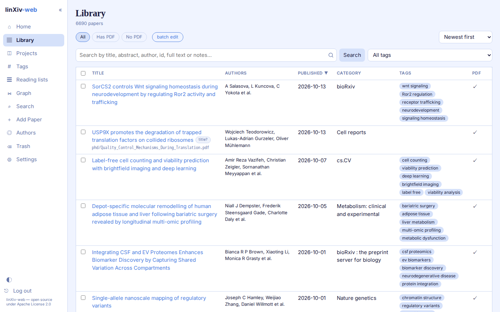
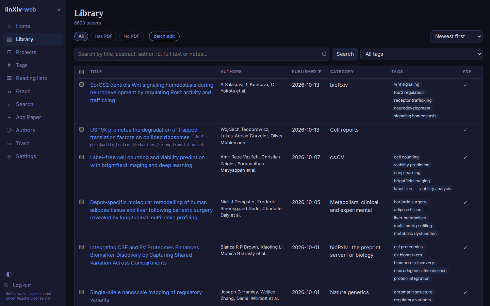

# Library

The Library lists every paper, 50 per page by default, with a page-size choice at the bottom.

## Searching and filtering

The search box covers title, abstract, authors, ids, tags, notes and indexed full text. A query of 3 or more characters also searches the TeX source and PDF text that linXiv has indexed. The chips above the table filter by PDF (All, Has PDF, No PDF) and the tag menu filters by one tag or by untagged papers.

Filters, sort order and page number are kept in the address bar, so a reload or the Back button returns to the same view, and you can bookmark it.

## Sorting

Click any column header (Title, Authors, Published, Category, Tags, PDF) to sort by it, and click again to reverse. The sort menu on the right does the same for the common orders.

In **Settings → Appearance → Paper tables** you can hide columns, change their widths, and show the DOI under each title.

## Suspect titles

Papers imported from PDFs sometimes get a junk title read from the file. linXiv-web flags those with a `title?` pill and shows the PDF file name under the title, so you can tell which file the row came from. Fix them with metadata lookup on the paper page or in batch edit, using "Search by PDF file name" when the file names are real titles.

## Batch edit

Tick papers and open **batch edit** to:

- look up and apply metadata from Crossref, arXiv, OpenAlex, PubMed or bioRxiv/medRxiv, with a field diff before anything is saved;
- add or remove tags, or ask the AI for tags if AI features are on;
- export the selection as a `.bib` file.

While a batch runs, leaving the page asks for confirmation, because leaving stops the batch.

## Dark mode

The theme follows your system setting until you pick light or dark with the toggle at the bottom of the sidebar or in **Settings → Appearance**.
