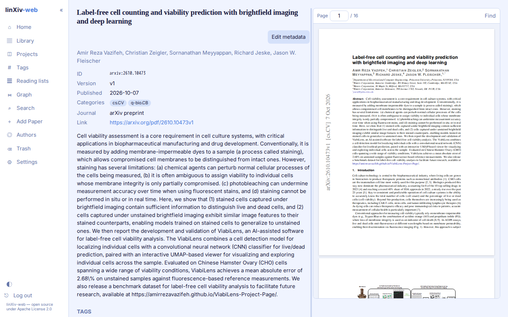

# Paper page

Each paper has its own page with metadata, abstract, tags, projects, notes, highlights and the PDF.

## Metadata

The top block shows id, version, publication date, categories, journal and link. **Edit metadata** opens an editor that can look the paper up in Crossref, arXiv, OpenAlex, PubMed or bioRxiv/medRxiv and show the result next to the stored values. Pick the fields to take, then save. The default lookup source and which sources are on are set in **Settings → Library → Metadata lookup**.

A paper can be saved without authors; linXiv then stores the author as `Unknown`.

## PDF reader

**View PDF** opens the PDF to the right of the page. Drag the bar between the two panes to resize them; the width is remembered in your browser. Scrolling inside the PDF stays inside the PDF. On narrow screens the panes stack.

The reader has page navigation and find (<kbd>Ctrl</kbd>/<kbd>Cmd</kbd>+<kbd>F</kbd> or <kbd>/</kbd>). Select text to create a highlight. **Open in new tab** opens the file in the browser's own viewer. Delete PDF waits 5 seconds with an Undo button before it deletes.

## Tags, projects and notes

Add tags as a comma-separated list, or use **AI Tags** for suggestions when AI features are on. The Projects section adds the paper to an existing project or reading list, or creates a new one.

Notes are Markdown. **Export .md** saves the paper's notes for Obsidian. **AI summary** writes a summary from the abstract, or from the abstract plus PDF text, and saves it as a note when you ask.

## Full text

For arXiv papers, **Fetch TeX source** downloads the LaTeX source and indexes its text for search. For other papers, **Index PDF text** indexes the PDF's text instead. A background worker can index all pending arXiv papers; see [Settings](settings.md).

## Papers in the shared library

In multi-user mode, a paper opened from the shared library shows its metadata, abstract, tags and PDF, plus a **Copy to my library** button. Accounts that are not admins don't get the editing controls there: edit metadata, tags, projects, AI summary, PDF download or delete, full text and delete. See [Server Admin](../server-admin.md#the-shared-library).

## Versions

arXiv version monitoring in **Settings → Library** checks saved arXiv papers for newer versions and lists each one with a link to the paper and a Dismiss button.
