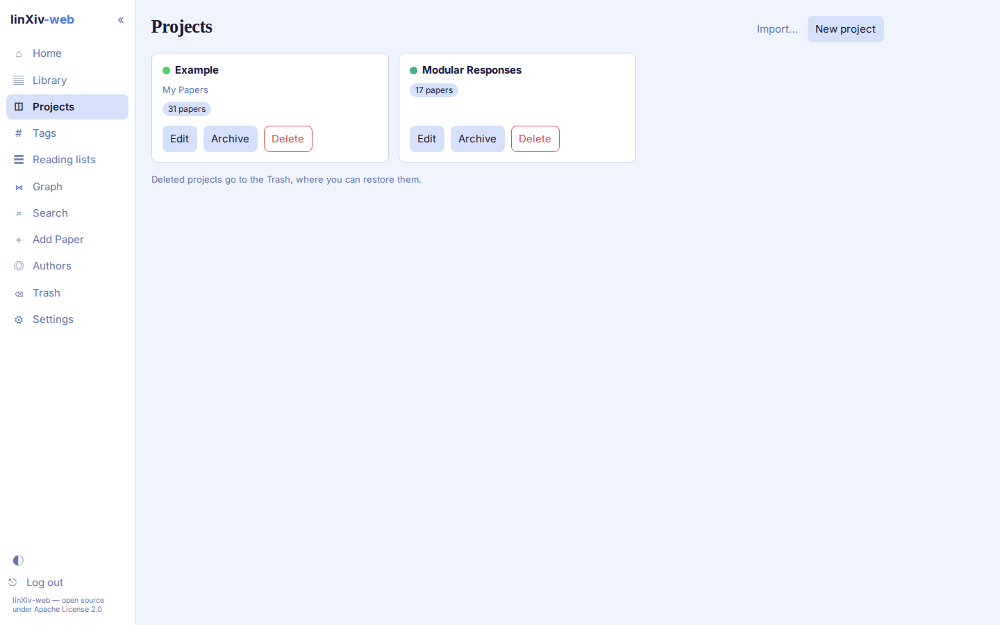
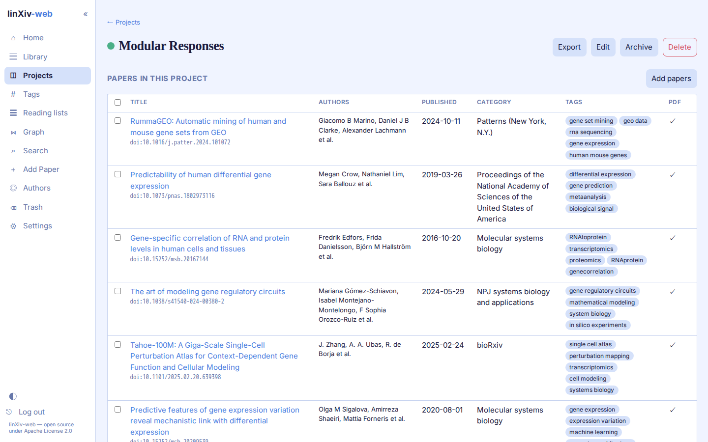
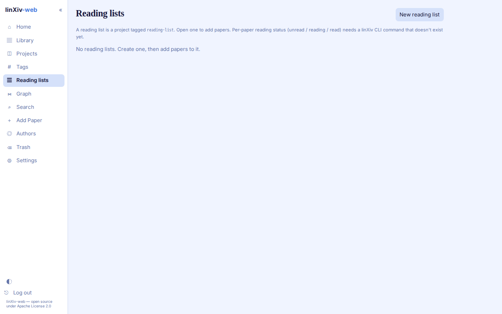

# Projects and reading lists

## Projects

The Projects page shows one card per active project, with its description and paper count. A switch shows archived projects instead, and deleted projects go to the [Trash](trash-backup.md).

A project page lists its papers in the same sortable table as the Library. **Add papers** searches the library, and **Export** writes the project as:

- `.lxproj` (optionally with PDFs), which another linXiv library can import;
- BibTeX;
- an Obsidian vault;
- Zotero;
- notes as a Markdown `.zip`.

**Import...** on the Projects page reads a `.lxproj` file. It shows a preview first and asks whether to merge with or overwrite a project of the same name.

## Reading lists

A reading list is a project tagged `reading-list`. Reading lists have their own page and stay off the Projects page. Open one to add papers.

linXiv keeps a per-paper reading status (unread, reading, read) only in its `linxiv-headless` HTTP API, not in the CLI, so linXiv-web can't show it yet. See [Functions not in the CLI](../functions-not-in-api.md).
