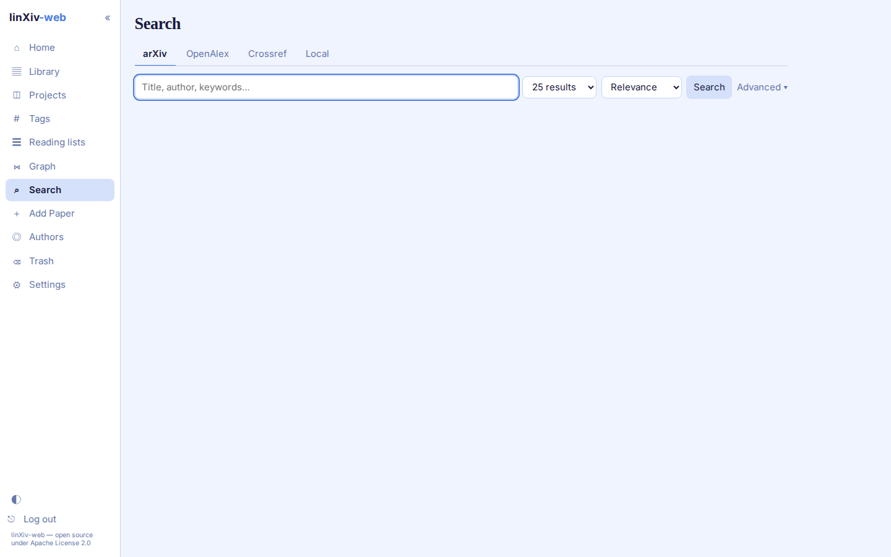
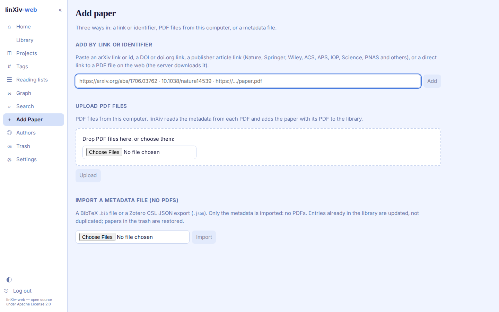

# Search and add papers

## Search

The Search page has tabs for arXiv, OpenAlex, Crossref and your local library. Pick how many results you want and the sort order, then search.

**Advanced** opens an arXiv query builder: each clause searches all fields, title, author or abstract, and clauses combine with AND, OR or AND NOT. Results already in your library link to their paper page.

## Add paper

The Add paper page has three sections.

Add by link or identifier
:   Paste an arXiv link or id, a DOI or doi.org link, a publisher article link (Nature, Springer, Wiley, ACS, APS, IOP, Science, PNAS and others), or a direct link to a PDF. For a PDF link the server downloads the file itself, from public hosts only and up to the upload size cap.

Upload PDF files
:   Drop PDFs or choose them. linXiv reads the metadata from each PDF and adds the paper with its PDF.

Import a metadata file
:   A BibTeX `.bib` file or a Zotero CSL JSON export. Only metadata is imported, no PDFs. Entries already in the library are updated, and papers in the trash are restored.

To import a whole folder of PDFs that is already on the server, use the [bulk import script](../bulk-import.md).
