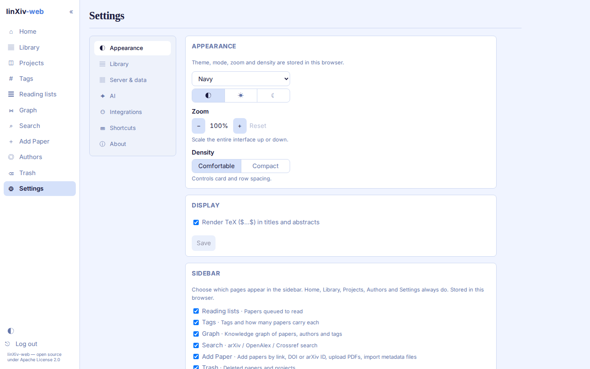
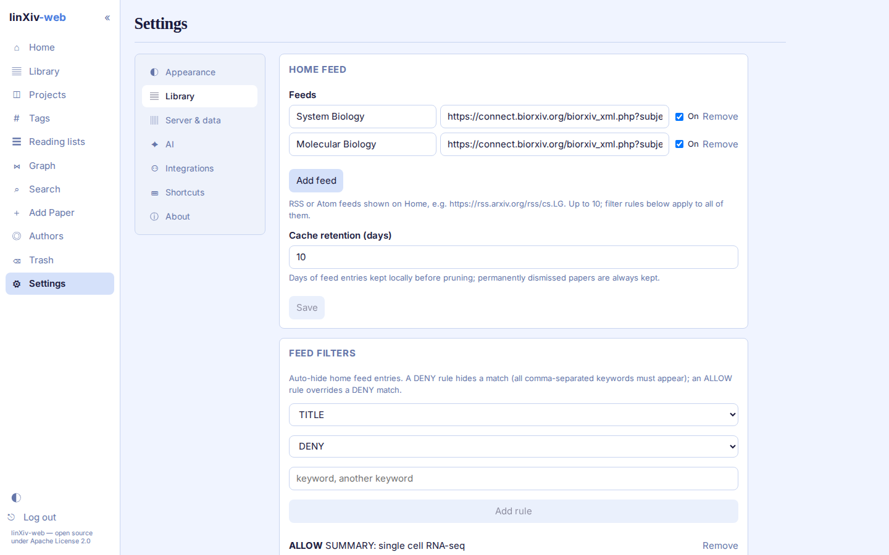
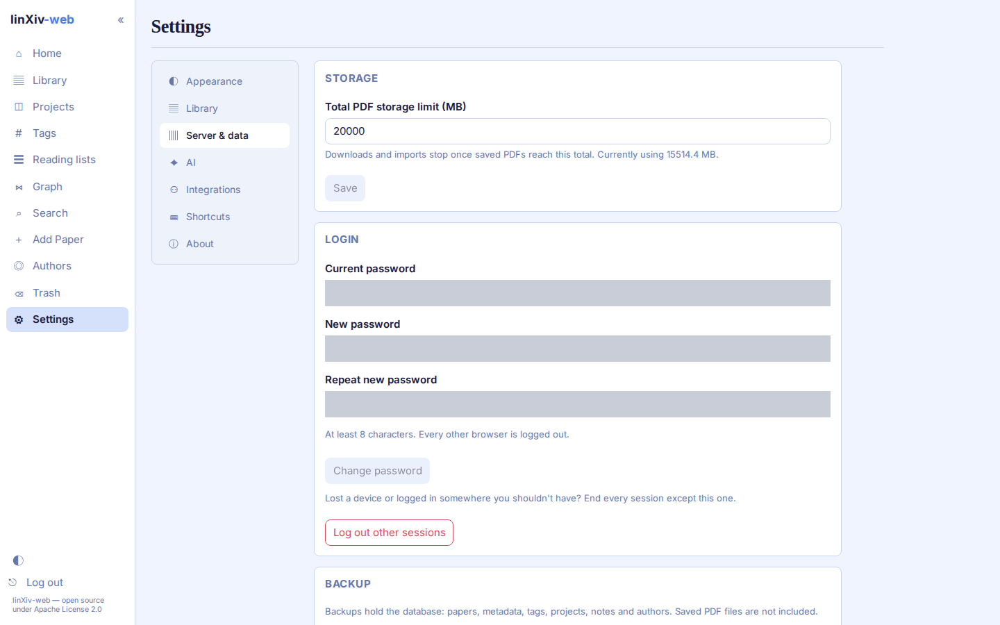
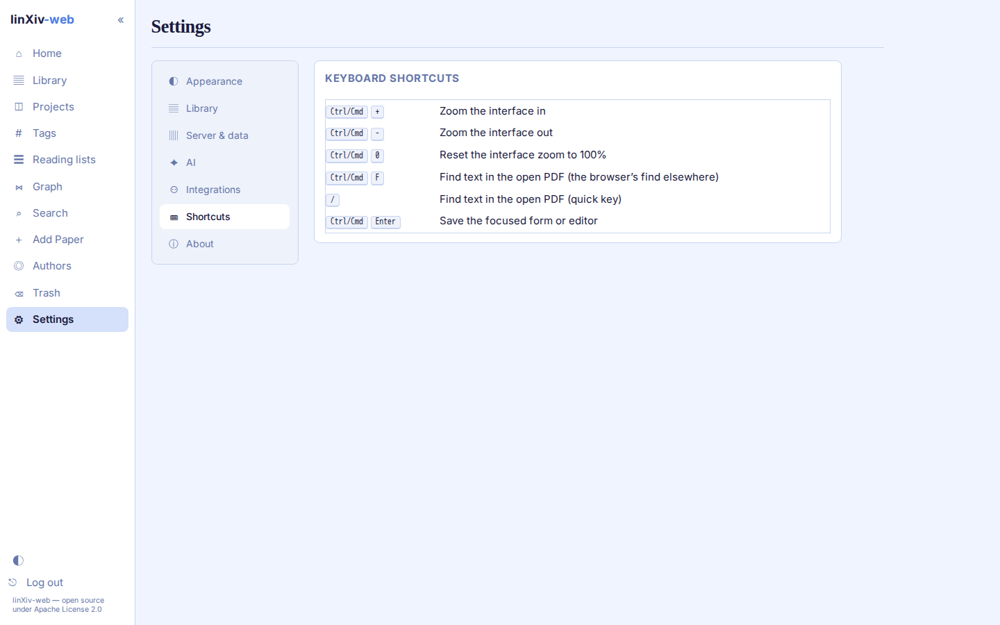
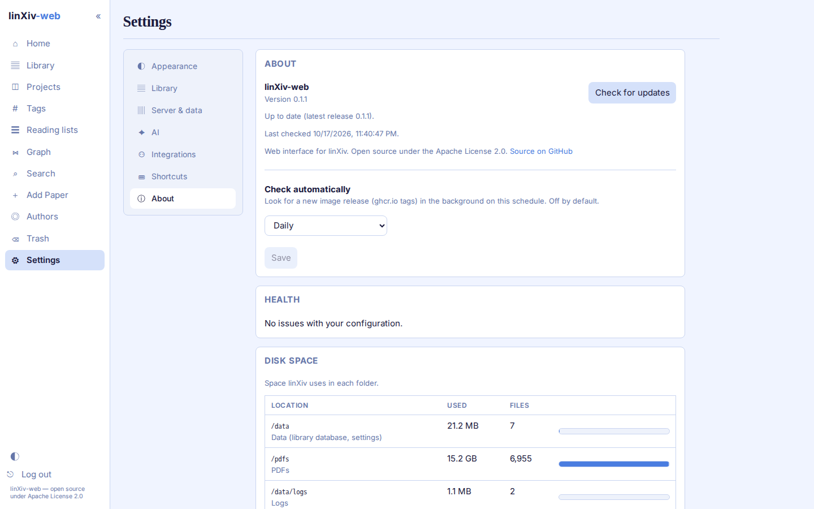

# Settings

Settings are split into groups listed on the left. Each card has its own Save button. You can link to a group directly, for example `/settings#ai`.

Settings marked as stored in the browser (theme, zoom, density, sidebar pages, paper table columns) apply to that browser only. Everything else is stored on the server.

## Appearance

Theme, light/dark/system mode, zoom and density. Display turns TeX rendering in titles and abstracts on or off. Sidebar picks which pages appear in the sidebar; Home, Library, Projects, Authors and Settings always do. Paper tables sets the visible columns, their widths and where the DOI is shown.

## Library

- Home feed: the feeds on the home page and how long entries are kept. See [Home feed](home-feed.md).
- Feed filters: DENY and ALLOW rules for feed entries.
- Search: whether search terms are saved for autocomplete, and how many.
- Metadata lookup: which sources are on and the default one.
- Contacts & API keys: contact addresses sent to arXiv, Crossref and OpenAlex, and the NCBI key for PubMed. Values set as environment variables take precedence.
- Full-text index: the background worker that fetches and indexes TeX source for saved arXiv papers.
- PDF full text: indexes PDF text for papers without TeX source.
- arXiv version monitoring: checks saved arXiv papers for newer versions.
- PDF folders: arranges the PDF folder by year, journal, or both, with a preview before any file moves.

## Server & data

Storage sets a cap on total PDF size; downloads and imports stop once saved PDFs reach it. Login changes your password and can log out every other session. Backup downloads, imports or restores the database of the library you are looking at, and exports or imports its settings as a JSON file. Logs shows the server log, and Activity lists every change made through the API, with the account that made it in multi-user mode.

## AI

Switch AI features on, choose a provider, model and key, and test the connection. Author ORCIDs fills in missing ORCIDs. See [AI features](../ai.md).

API keys are write-only. After saving, the page shows only their last 4 characters.

## Integrations

The MCP server for Claude Code, Codex and OpenCode: switch it on, choose the tool profile and create the access token. See [MCP server](../mcp.md).

## Server Admin

Admins only. Multi-user mode turns named accounts and the shared library on or off, and Users adds, edits and deletes accounts. Maintenance operations finds duplicate papers, completes metadata of new papers, checks PDF files, backs up the databases and cleans up old files and trash, on demand or nightly. See [Server Admin](../server-admin.md) and [Maintenance operations](../server-admin.md#maintenance-operations).

In multi-user mode, accounts that are not admins see fewer settings: no Integrations or Server Admin group, no Logs or Activity card, and About shows the version only. Their AI keys, contacts, feeds and lookup choices belong to their own library.

## Shortcuts

## About

Version, update check against the published image (by hand or daily, weekly or monthly), health warnings about the configuration, disk space used by the data, PDF and log folders, and a diagnostics report for bug reports.

