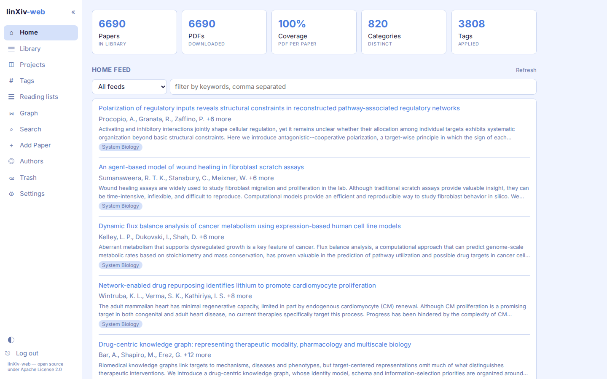
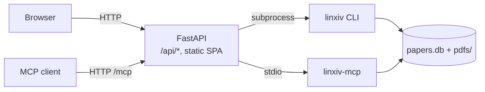

# linXiv-web

linXiv-web is a browser UI for [linXiv](https://github.com/linxiv-dev/linXiv). You can search arXiv, OpenAlex and Crossref, add papers to a library, tag them, group them into projects and reading lists, read and highlight their PDFs, and take notes.

It is a separate project written to fit the [linxiv-dev](https://github.com/linxiv-dev) organization. The linXiv maintainers have not adopted it, so it is not an official linXiv component.

## Features

- Library: a sortable table (click any column header) and one search box covering title, abstract, authors, ids, tags, indexed full text and notes. You can filter by PDF and edit metadata for many papers at once.
- Papers: edit metadata, look it up and compare it side by side with Crossref, arXiv, OpenAlex, PubMed and bioRxiv/medRxiv. Each paper has versions, tags, notes and a PDF reader with find and highlights. arXiv TeX source can be indexed for full-text search.
- Projects and reading lists: projects export to BibTeX, Obsidian, Zotero and `.lxproj`, and `.lxproj` files import back. Reading lists have their own page.
- Discovery: search tabs for arXiv, OpenAlex, Crossref and the local library, with an advanced arXiv query builder. Add papers by arXiv id, DOI or PDF link. The home page shows RSS/Atom feeds with filter rules, and a monitor reports new arXiv versions.
- Authors and graph: author pages, edit and merge, ORCID backfill, and a knowledge graph of papers, authors and tags.
- Maintenance: trash, backup, import and restore of the database, PDF folder layouts (by year, journal or both) and a background full-text indexer.
- AI (opt-in): tag suggestions, paper summaries saved as notes and metadata cleanup, with Gemini, OpenAI, Anthropic or any OpenAI-compatible server (LM Studio, Ollama, vLLM, OpenRouter). See [AI features](ai.md).
- MCP (opt-in): linXiv's own MCP tools over HTTP at `/mcp`, for Claude Code, Codex and OpenCode. See [MCP server](mcp.md).
- Light and dark themes, zoom and density, keyboard shortcuts and sidebar page toggles.

## How it works

linXiv-web talks to linXiv through the `linxiv` CLI, which prints JSON for every command. A FastAPI server runs `linxiv <command>` as a subprocess, passing arguments as a list without a shell, and serves a React single-page app.

Library reads and writes go through the CLI, with two exceptions where the CLI has no command. PDF folder layouts move files and update their stored path in `papers.db` directly (under the CLI lock), and the AI summary reads text from a saved PDF.

The server contacts outside services itself in three cases only:

- it downloads a PDF link pasted into Add Paper before importing it (public hosts only, size-capped);
- metadata lookup queries PubMed through NCBI E-utilities (`eutils.ncbi.nlm.nih.gov`) and bioRxiv/medRxiv through `api.biorxiv.org`;
- with AI features on, an AI action sends the paper's title, abstract and, if you choose, PDF text to the provider you configured. Nothing is sent until you click an AI button.

A linXiv library allows one writing process per data dir, so the server runs CLI calls one at a time behind a lock. Work that needs many calls, such as indexing the TeX source of every saved arXiv paper, runs as a background job that makes one call per paper, so other requests get the lock in between. Jobs live in memory: restarting the server stops a running job and forgets finished ones. Don't point linXiv-web at a data dir that the desktop app or `linxiv-headless` also uses.

`linxiv` always writes PDFs to `<data dir>/pdfs`. The container makes that path a symlink to `/pdfs`, so the database can stay on local disk while the PDFs sit on other storage.

Like `linxiv-headless`, the server refuses to start on a non-loopback address without a password.

## Where to start

- To run it: [Self-hosting with Docker](self-hosting.md).
- To learn the pages: start with the [Library](guide/library.md).
- To change server settings: [Admin Server Configuration](reference/configuration.md).

linXiv-web is open source under the Apache License 2.0.
