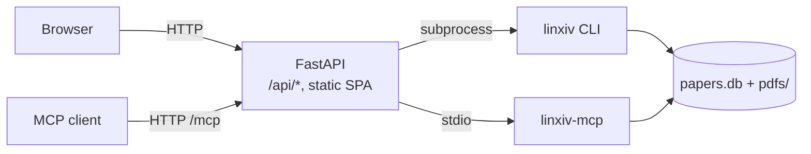

# linXiv-web

linXiv-web is a browser UI for [linXiv](https://github.com/linxiv-dev/linXiv). You can search arXiv, OpenAlex and Crossref, add papers to a library, tag them, group them into projects and reading lists, read and highlight their PDFs, and take notes.

It follows the [linxiv-dev](https://github.com/linxiv-dev) organization, but the linXiv maintainers have not adopted it and it remains unofficial.

## Live demo

Try it at <https://linxiv-web.onrender.com> with the password `trymelinxiv-web`.

## Features

- Library: a sortable table (click any column header) and one search box covering title, abstract, authors, ids, tags, indexed full text and notes. You can filter by PDF and edit metadata for many papers at once.
- Papers: edit metadata, look it up and compare it side by side with Crossref, arXiv, OpenAlex, PubMed and bioRxiv/medRxiv. Each paper has versions, tags, notes and a PDF reader with find and highlights. arXiv TeX source can be indexed for full-text search.
- Projects and reading lists: projects export to BibTeX, Obsidian, Zotero and `.lxproj`, and `.lxproj` files import back. Reading lists have their own page.
- Discovery: search tabs for arXiv, OpenAlex, Crossref and the local library, with an advanced arXiv query builder. Add papers by arXiv id, DOI or PDF link. The home page shows RSS/Atom feeds with filter rules, and a monitor reports new arXiv versions.
- Authors and graph: author pages, edit and merge, ORCID backfill, and a knowledge graph of papers, authors and tags.
- Maintenance: trash, backup, import and restore of the database, settings export and import, PDF folder layouts (by year, journal or both) and a background full-text indexer. Admins also get [maintenance operations](server-admin.md#maintenance-operations), on demand or nightly: duplicate papers, metadata of new papers, PDF file check, server-side database backups, authors without papers, old trash.
- AI (opt-in): tag suggestions, paper summaries saved as notes, metadata cleanup. See [AI features](ai.md).
- MCP (opt-in): linXiv's own MCP tools over HTTP at `/mcp`, for any AI tool that speaks MCP. See [MCP server](mcp.md).
- Several users (opt-in): named accounts with their own libraries and settings, admin and user roles, and a shared library that admins fill and everyone can copy papers from. See [Server Admin](server-admin.md).
- Light and dark themes, zoom and density, keyboard shortcuts and sidebar page toggles.

## How it works

linXiv-web talks to linXiv through the `linxiv` CLI, which prints JSON for every command. A FastAPI server runs `linxiv <command>` as a subprocess, passing arguments as a list without a shell, and serves a React single-page app.

Library reads and writes go through the CLI, with two exceptions where the CLI has no command. PDF folder layouts move files and update their stored path in `papers.db` directly (under the CLI lock), and the AI summary reads text from a saved PDF.

linXiv-web is meant to stay local. The server contacts outside services itself only in these cases:

- It downloads a PDF link pasted into Add Paper before importing it (public hosts only, size-capped).
- Metadata lookup queries PubMed through NCBI E-utilities (`eutils.ncbi.nlm.nih.gov`), bioRxiv/medRxiv through `api.biorxiv.org`, and other lookup sources.
- When AI features are on, AI actions send the paper's title and abstract, and PDF text if you choose, to the provider you configured, unless that provider runs locally. Nothing is sent until you click an AI button.

A linXiv library allows one writing process per data dir, so the server runs CLI calls one at a time behind a lock. Work that needs many calls, such as indexing the TeX source of every saved arXiv paper, runs as a background job that makes one call per paper, so other requests get the lock in between. Jobs live in memory: restarting the server stops a running job and forgets finished ones.

`linxiv` always writes PDFs to `<data dir>/pdfs`. The container makes that path a symlink to `/pdfs`, so the database can stay on local disk while the PDFs sit on other storage.

Like `linxiv-headless`, the server refuses to start on a non-loopback address without a password.

## Where to start

- To run it: [Self-hosting with Docker](self-hosting.md).
- To learn the pages: start with the [Library](guide/library.md).
- To change server settings: [Admin Server Configuration](reference/configuration.md).
- To add accounts and a shared library: [Server Admin](server-admin.md).

linXiv-web is open source under the Apache License 2.0.
