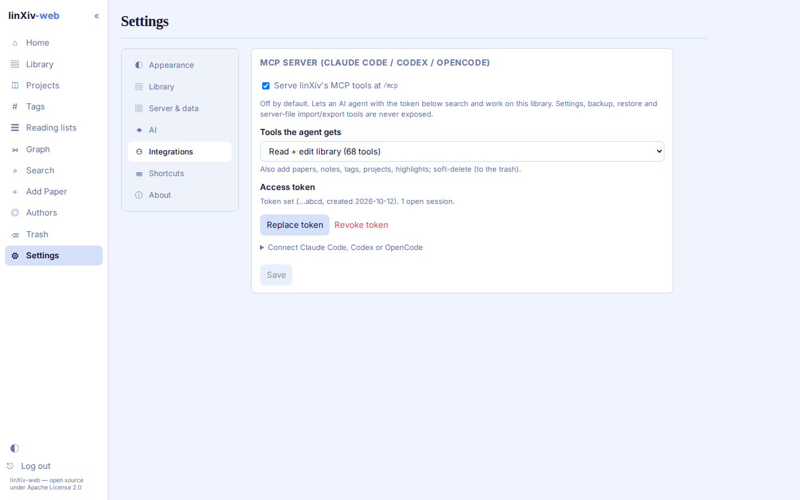

# MCP server

linXiv-web can serve linXiv's own MCP tools over HTTP, so an AI agent such as Claude Code, Codex or OpenCode can search and work on your library. It is off by default.

Upstream linXiv ships `linxiv-mcp` as a local stdio server for the desktop app (see the [linXiv README](https://github.com/linxiv-dev/linXiv#mcp-server)). linXiv-web builds the same binary and bridges it to MCP Streamable HTTP at `/mcp`, with a bearer token and a choice of which tools the agent gets.

## How it works

```
MCP client ──HTTP /mcp──▶ FastAPI ──stdio──▶ linxiv-mcp ──▶ papers.db + pdfs/
```

- Each MCP session (one `initialize`) gets its own `linxiv-mcp` process. At most 4 sessions run at once; a session closes after 30 minutes idle, and a restart of the container drops all sessions (clients re-initialize).
- Requests in one session run one at a time. Replies are plain JSON; `GET /mcp` answers 405 (no server-sent events).
- Which tools a client sees and may call is decided by the bridge (`server/app/mcp_bridge.py`), not by `linxiv-mcp`.

## Turning it on

1. Open **Settings → Integrations**.
2. Tick **Serve linXiv's MCP tools at /mcp** and pick the tools the agent gets (see [Profiles](#profiles)). Save.
3. Click **Create token**. The token is shown once; only its SHA-256 is stored. **Replace token** or **Revoke token** disconnects every open session.

The card then shows the connect commands below with your server URL and token filled in.



## Connecting a client

Use your server's address in place of `http://127.0.0.1:8086`, for example the HTTPS name behind your reverse proxy.

### Claude Code

```sh
claude mcp add --transport http linxiv http://127.0.0.1:8086/mcp --header "Authorization: Bearer <token>"
```

Add `--scope local` (this project only, the default), `--scope user` (every project) or `--scope project` (writes `.mcp.json` into the repository, so keep the token out of git). Check with `claude mcp list`; the tools appear as `mcp__linxiv__*` after a restart or `/mcp` reconnect.

### Codex

Codex reads the token from an environment variable, which must be set in the shell that starts Codex:

```sh
export LINXIV_MCP_TOKEN=<token>
codex mcp add linxiv --url http://127.0.0.1:8086/mcp --bearer-token-env-var LINXIV_MCP_TOKEN
```

or in `~/.codex/config.toml`:

```toml
[mcp_servers.linxiv]
url = "http://127.0.0.1:8086/mcp"
bearer_token_env_var = "LINXIV_MCP_TOKEN"
```

### OpenCode

Add a remote server to `opencode.json` (per project) or to your global OpenCode config. `{env:LINXIV_MCP_TOKEN}` reads the token from the environment, so set it as for Codex:

```json
{
  "$schema": "https://opencode.ai/config.json",
  "mcp": {
    "linxiv": {
      "type": "remote",
      "url": "http://127.0.0.1:8086/mcp",
      "enabled": true,
      "headers": { "Authorization": "Bearer {env:LINXIV_MCP_TOKEN}" }
    }
  }
}
```

## Profiles

| Profile | Tools | Adds |
|---|---|---|
| Read only (default) | 32 | search, get, list, refs, stats |
| Read + edit library | 68 | papers, notes, tags, projects, highlights; soft deletes (to the trash) |
| Full | 75 | hard deletes, merging papers or authors, metadata overwrite |

Never exposed, in any profile:

- `get_settings`, `update_setting`: the settings store holds API keys.
- `backup_database`, `restore_database`, `import_pdf`, `import_bibtex`, `import_zotero`, `import_project`, `export_project`, `export_project_bibtex`, `export_project_obsidian`, `export_project_zotero`, `set_full_text`: they read or write file paths on the server. Use the web UI for these.

`download_pdf` with a caller-chosen `url` is refused; the paper's stored link is used, so the agent cannot make the server fetch an arbitrary host.

Tools added in a new upstream release stay hidden until they are classified in `mcp_bridge.py` (a test against the real binary fails on any unclassified tool).

## Permission hints

`linxiv-mcp` sets no MCP tool annotations, so the bridge adds them to every tool in `tools/list`, derived from the tool's profile tier. Clients use them to decide when to ask before a call.

| Hint | Set on |
|---|---|
| `readOnlyHint: true` | every Read only tool |
| `readOnlyHint: false`, `destructiveHint: false` | Read + edit tools: changes you can undo (soft deletes go to the trash) |
| `destructiveHint: true` | Full tools: permanent deletes, merges, metadata overwrite |
| `idempotentHint: true` | edits that change nothing when repeated (adding/removing tags or project papers, restore, archive, `create_tag`) |
| `openWorldHint: true` | tools that call outside services (arXiv, DOI resolvers, feeds, ORCID sources) |
| `title` | readable name, e.g. `List papers` |

Hints are advice to the client, not access control: the profile decides what can be called. A reasonable client setup is to auto-allow read-only tools and always confirm destructive ones by hand.

## Tool reference

Descriptions come from `linxiv-mcp` (linXiv v0.7.0). Hints: read-only, edit (undoable), destructive (permanent), idempotent, open world (calls outside services).

### Read only (32 tools)

| Tool | What it does | Hints |
|---|---|---|
| `author_merge_candidates` | Find likely duplicate authors — other authors sharing this author's ORCID. Feed the result to merge_authors. | read-only |
| `find_doi_candidates` | Find other papers sharing this paper's DOI — likely the same work resolved from a different source. | read-only |
| `full_text_pending` | List stored arXiv papers whose TeX source has not been indexed yet — the backlog fetch_full_text still has to work through. Read-only. | read-only |
| `get_annotation` | Get a single annotation by its id. | read-only |
| `get_author` | Get an author's details together with a preview of their papers. | read-only |
| `get_note` | Get a single note by its id. | read-only |
| `get_notes_for_paper` | Retrieve notes attached to a paper. | read-only |
| `get_notes_for_project` | Retrieve all notes scoped to a project, across all its papers. | read-only |
| `get_paper` | Get full metadata for a single paper from the local database. | read-only |
| `get_paper_tags` | Get all tags applied to a specific paper. | read-only |
| `get_paper_versions` | Get all stored versions of a paper. | read-only |
| `get_pdf_path` | Get the local filesystem path for a paper's PDF, if downloaded. | read-only |
| `get_pdf_storage` | Report total PDF storage usage for all managed PDFs. | read-only |
| `get_project` | Get full details for a project. | read-only |
| `get_project_tags` | Get all tags applied to a project. | read-only |
| `get_stats` | Report library statistics: paper, tag, category, and downloaded-PDF counts, plus the 10 newest papers. | read-only |
| `list_all_tags` | List all tags in the database. | read-only |
| `list_annotations` | List PDF annotations, optionally filtered by paper or project. | read-only |
| `list_authors` | List authors that have at least one active paper in the library, with their paper counts. | read-only |
| `list_categories` | List all distinct paper categories present in the library. | read-only |
| `list_feed_rules` | List the feed auto-filter rules. | read-only |
| `list_new_versions` | List saved papers with an unacknowledged new arXiv version. | read-only |
| `list_notes` | List notes, optionally filtered by paper or project. | read-only |
| `list_papers` | List papers stored in the local database, optionally sorted by publication date, date added, or title. | read-only |
| `list_pdfs` | List every paper whose PDF is stored on disk, with file sizes, largest first (capped at 200). | read-only |
| `list_projects` | List research projects. | read-only |
| `list_trash` | List all soft-deleted papers and projects currently in the trash. | read-only |
| `paper_ref` | Citation handle linxiv://paper/{source_fk}?v={version} for a saved paper, pinned to a stored version (latest by default). Paste it into notes; verify later with resolve_refs. | read-only |
| `resolve_doi` | Resolve a DOI to paper metadata without saving it to the library. | read-only, open world |
| `resolve_refs` | Verify citation refs (linxiv://paper/{source_fk}?v={version}). Each comes back current, stale (newer version stored), unknown (no such paper or version), or malformed. | read-only |
| `search_full_text` | Full-text search over downloaded TeX source and note content. | read-only |
| `search_papers` | Search for academic papers by keyword. | read-only, open world |

### Read + edit library (36 more)

| Tool | What it does | Hints |
|---|---|---|
| `ack_version` | Clear the new-version flag on one paper. | edit, idempotent |
| `add_paper_to_project` | Add a paper to an existing project. | edit, idempotent |
| `add_papers_to_project` | Add several papers to a project in one call. Ids that are not in the local database come back in `failed` instead of failing the whole call. | edit, idempotent |
| `add_tags_to_paper` | Add one or more tags to a paper. | edit, idempotent |
| `add_tags_to_project` | Add one or more tags to a project. | edit, idempotent |
| `archive_project` | Archive a project (read-only, still visible). | edit, idempotent |
| `check_versions` | Poll arXiv once for new versions of the stalest saved papers. Newer versions are saved and flagged; one pass runs at a time. | edit, open world |
| `create_annotation` | Create a PDF highlight annotation on a paper, optionally scoped to a project. | edit |
| `create_feed_rule` | Create a feed auto-filter rule: keywords matched against a field, DENY (default) or ALLOW. | edit |
| `create_note` | Create a note attached to a paper, optionally scoped to a project. | edit |
| `create_project` | Create a new research project. | edit |
| `create_tag` | Create a new tag (or return its id if it already exists). | edit, idempotent |
| `delete_annotation` | Delete a PDF annotation by its id. | edit |
| `delete_feed_rule` | Delete a feed auto-filter rule by id. | edit |
| `delete_note` | Delete a note by its id. | edit |
| `delete_paper` | Soft-delete a paper from the local database (moves it to trash). | edit |
| `delete_project` | Soft-delete a project (moves it to trash). | edit |
| `delete_tag` | Delete a tag by its id. | edit |
| `dismiss_feed_entry` | Hide a feed entry by arXiv id and version, or block the whole paper with permanent. | edit |
| `download_pdf` | Download a PDF for a paper and save it to the managed PDF directory. | edit, open world |
| `fetch_full_text` | Download a paper's arXiv TeX source and index it so search_full_text can find it. arXiv only; an already-indexed paper is skipped unless force=true. | edit, open world |
| `fetch_paper` | Fetch full metadata for a paper by id and save it to the local database. | edit, open world |
| `get_feed` | Fetch an RSS/Atom feed URL (throttled to once per 5 minutes per URL), merge it into the cached window, and return the filtered page with which entries are already saved. | edit, open world |
| `orcid_backfill` | Fill missing ORCIDs onto DOI-linked authors via CrossRef then OpenAlex. One paced pass; only one may run at a time. | edit, open world |
| `remove_paper_from_all_projects` | Remove a paper from every project it currently belongs to. | edit, idempotent |
| `remove_paper_from_project` | Remove a paper from a project. | edit, idempotent |
| `remove_tags_from_paper` | Remove one or more tags from a paper. | edit, idempotent |
| `remove_tags_from_project` | Remove one or more tags from a project. | edit, idempotent |
| `restore_paper` | Restore a soft-deleted (trashed) paper back into the library. | edit, idempotent |
| `restore_project` | Restore an archived or soft-deleted project back to active status. | edit, idempotent |
| `restore_project_from_trash` | Restore a project from the trash. Only works if the project is soft-deleted. | edit, idempotent |
| `save_doi` | Resolve a DOI and save the resulting paper to the local library. | edit, open world |
| `update_annotation` | Update a PDF annotation's written comment. | edit |
| `update_author` | Update an author's fields. At least one field must be provided. | edit |
| `update_note` | Update a note's title and/or content. | edit |
| `update_project` | Update a project's name, description, color, tags, or lifecycle status. | edit |

### Full (7 more)

| Tool | What it does | Hints |
|---|---|---|
| `delete_author` | Delete an author. Blocked if the author is still linked to any papers. | destructive |
| `delete_pdf` | Delete a paper's stored PDF files from disk — every version — keeping the paper record itself. | destructive |
| `hard_delete_project_from_trash` | Permanently delete a trashed project. Only works if the project is soft-deleted unless `force` is true, which skips the trash and deletes an active project. Irreversible; papers themselves are kept. | destructive |
| `merge_authors` | Merge duplicate authors into one canonical author, re-pointing all their papers. | destructive |
| `merge_papers` | Merge a duplicate paper into another: the winner's metadata stays canonical; the duplicate's notes, annotations, project memberships, tags, missing versions and PDFs move over, then the duplicate is deleted. Refuses self-merges, trashed papers, and duplicates that belong to a shared project. | destructive |
| `repair_paper` | Overwrite a paper's metadata in-place to fix a bad import. | destructive |
| `trash_hard_delete_paper` | Permanently delete a trashed paper. Only works if the paper is in the trash unless `force` is true, which skips the trash and deletes an active paper. Irreversible. | destructive |

## Security

- `/mcp` does not use the browser login or CSRF token. It needs `Authorization: Bearer <token>`; a missing or wrong token gets 401.
- While the switch is off, `/mcp` answers 404.
- A request carrying another site's `Origin` header is refused with 403, which blocks DNS-rebinding attacks from a browser.
- Behind a reverse proxy, pass the `Host` header through (see [self-hosting.md](self-hosting.md#https-with-a-reverse-proxy)) so the `Origin` check compares against the public name.
- Pick the smallest profile that does the job. Full lets an agent delete papers and projects permanently.

## Troubleshooting

Probe the endpoint by hand. Streamable HTTP needs the `Mcp-Session-Id` returned by `initialize` on every later request:

```sh
URL=http://127.0.0.1:8086/mcp
AUTH="Authorization: Bearer $LINXIV_MCP_TOKEN"
ACCEPT="Accept: application/json, text/event-stream"
CT="Content-Type: application/json"

SID=$(curl -s -D - -o /dev/null -X POST "$URL" -H "$AUTH" -H "$ACCEPT" -H "$CT" \
  -d '{"jsonrpc":"2.0","id":1,"method":"initialize","params":{"protocolVersion":"2025-06-18","capabilities":{},"clientInfo":{"name":"probe","version":"0"}}}' \
  | tr -d '\r' | awk -F': ' 'tolower($1)=="mcp-session-id"{print $2}')

curl -s -X POST "$URL" -H "$AUTH" -H "$ACCEPT" -H "$CT" -H "Mcp-Session-Id: $SID" \
  -d '{"jsonrpc":"2.0","method":"notifications/initialized"}'

curl -s -X POST "$URL" -H "$AUTH" -H "$ACCEPT" -H "$CT" -H "Mcp-Session-Id: $SID" \
  -d '{"jsonrpc":"2.0","id":2,"method":"tools/list"}' \
  | jq -r '.result.tools[] | "\(.name)\t\(.annotations.readOnlyHint)\t\(.annotations.destructiveHint)"'
```

| Reply | Cause |
|---|---|
| 404 on every request | MCP switched off in Settings, or wrong path |
| 401 | Missing, wrong, replaced or revoked token |
| 403 | Request carries a different site's `Origin` |
| 400 `Missing Mcp-Session-Id` | Request after `initialize` without the session header |
| 404 with a session id | Session closed (idle, replaced token, restart); initialize again |
| `Tool not available on this server` | Tool is outside the chosen profile or always blocked |

The current session count shows on the Settings card.
