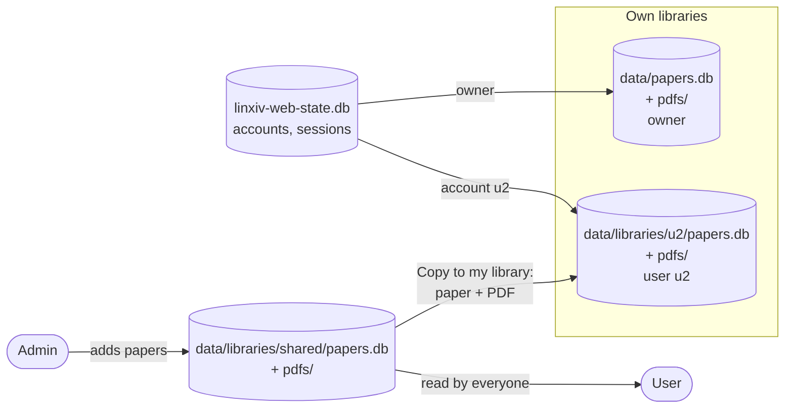
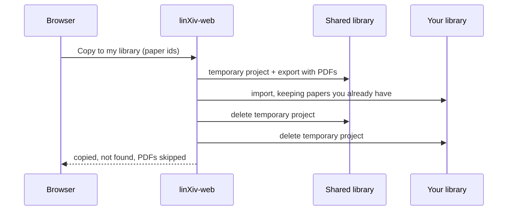

# Server Admin

Out of the box linXiv-web has one password and one library. Multi-user mode adds named accounts, each with its own library, plus a shared library that everyone can read and only admins can change. It stays off until an admin turns it on, and turning it on leaves your existing library as it is.

## Multi-user mode

Open **Settings → Server Admin → Multi-user mode**, choose your username and click **Turn on**. You keep the server password (the one set in `.env` or during first-run setup), and your library stays your own. From then on the login page asks for a username and a password.

The account that turned the mode on is the server owner. It always stays an admin and can't be deleted.

Only the owner can turn the mode off. Everyone else is logged out at once, and afterwards only the owner can log in, with the password alone as before. Accounts, their libraries and the shared library are kept and come back when the mode is turned on again.

## Accounts

**Settings → Server Admin → Users** lists every account with its role, library and creation date. From there an admin can:

- add an account with a username, a password and a role (user or admin);
- rename an account or set a new password for it;
- change its role;
- delete it.

Usernames use lowercase letters, digits, dot, dash and underscore, up to 32 characters. Passwords need at least 8 characters, and no two accounts may share one, the owner's server password included.

A new password, a role change or a deletion logs that account out of every browser at once. The last admin can't be demoted or deleted, and nobody can delete their own account.

Deleting an account removes the login only. Its library stays on disk, and the panel shows the folder so you can keep, move or remove it yourself.

## What admins and users can do

| | User | Admin |
|---|---|---|
| Own library: add, edit, tag, projects, notes, PDFs | Yes | Yes |
| Own settings: AI keys, contacts, feeds, metadata lookup | Yes | Yes |
| Read the shared library and copy papers from it | Yes | Yes |
| Change the shared library | No | Yes |
| Change own password | Yes | Yes |
| Server Admin: multi-user mode and accounts | No | Yes |
| Maintenance operations and server backups | No | Yes |
| Duplicates page: merge or dismiss in own library | Yes | Yes |
| App logs, activity log | No | Yes |
| Update check, health, disk space, diagnostics | No | Yes |
| MCP server and its token | No | Yes |
| Server-wide settings: log level, update check, `GHCR_TOKEN`, MCP | No | Yes |

Users don't see the settings cards and groups they can't use, and the server checks the role on every request.

## The shared library

The top of the sidebar switches between **My library** and **Shared library** (M and S when the sidebar is collapsed). The choice is remembered in each browser. In the shared library a banner says which one you are looking at.

Admins fill the shared library with the usual pages: Add Paper, Search, Upload and the Home feed all work on whichever library is shown.

For users the shared library is read only. They can browse and search it, open PDFs and export BibTeX. The buttons that would change it are hidden, and the server refuses those changes.

To keep a paper, select it in the Library and click **Copy to my library**, or use the same button on the paper page. The paper and its PDF land in your own library, and the shared copy stays where it is. If you already have the paper, your stored metadata is kept.

## How the databases relate

Accounts and libraries live in separate files. `linxiv-web-state.db` holds accounts and sessions, and each account points at one library. A library is an ordinary linXiv data folder with its own `papers.db`, settings and PDF folder.



Copy to my library goes through a project archive, the same way you would move a project by hand. The server puts the papers in a temporary project in the shared library, exports it with its PDFs, imports the archive into your library, and then deletes the temporary project on both sides. The papers themselves stay.



## Projects and reading lists

Projects and reading lists belong to one library, so accounts can't see each other's. An admin can create them in the shared library, where everyone can open them. Copying papers to your library leaves their project behind.

## Passwords

Change your own password in **Settings → Server & data → Login**. The owner's password is the server password: when it comes from `LINXIV_WEB_PASSWORD_HASH` or `LINXIV_WEB_PASSWORD`, change it in `.env`.

Admins set a new password for anyone in the Users panel. If nobody can log in, reset a password on the server, no restart needed:

```sh
# The owner (server password)
docker compose exec linxiv-web python -m app reset-password

# One account
docker compose exec linxiv-web python -m app reset-password --user alice
```

Either one logs that account out of every browser.

## Where the data lives

| Path in `data/` | Contents |
|---|---|
| `papers.db`, `user_settings.json`, `pdfs/` | The owner's library, as before |
| `libraries/shared/` | The shared library: `papers.db`, `user_settings.json`, `pdfs/` |
| `libraries/u<id>/` | One account's library, same layout |
| `linxiv-web-state.db` | Accounts (password hashes only), sessions, the multi-user switch |

Libraries are created the first time they are opened. To keep the PDFs of the shared and per-account libraries on another disk, set `LINXIV_WEB_LIBRARIES_PDF_DIR`; each library then links its `pdfs/` to `<that folder>/<library>`. The folder must not be inside `LINXIV_WEB_PDF_DIR`.

**Settings → Server & data → Backup** backs up, imports and restores the library you are looking at. Copying the whole `data/` and `pdfs/` folders, as in [Backups](self-hosting.md#backups), covers every library and every account.

## Maintenance operations

**Settings → Server Admin → Maintenance operations** lists jobs that look after every library on the server: the owner's, the shared one and each account's. Each row has a **Run** button, the result of its last run, and a **Nightly** box. Ticked operations run one after another once a night at the hour picked at the top of the card. The hour is the server's local time; set `TZ` on the container (for example `TZ=Europe/London`) when the server should not use UTC. A running operation shows its progress in the activity tray and can be cancelled.

| Operation | What it does |
|---|---|
| Find duplicate papers | Reads every saved PDF and lists papers whose files are byte for byte the same on the **Duplicates** page. Only new or changed files are read again on later runs. |
| Complete metadata of new papers | For papers added since its last run that have one of the gaps ticked on its row (junk title, no authors, date, abstract, journal or DOI), it looks the paper up by its own DOI or arXiv id, never by title, in the sources ticked on its row and in their order, and fills those empty fields. Stored values are kept. arXiv is asked only for arXiv papers, bioRxiv only for bioRxiv/medRxiv DOIs, Crossref and PubMed for any DOI. OpenAlex is not offered: linXiv can't look it up by an exact DOI. |
| Check PDF files | Reports papers whose PDF file is missing on disk, and PDF files in the PDF folder that no paper points at. It changes nothing. **Show report** lists them. |
| Back up databases | Saves a copy of each library's database on the server and keeps the newest ones (7 unless you change it below the table). PDF files are not included. |
| Clean authors without papers | Deletes author records that no paper uses any more, for example the authors of papers deleted from the trash. linXiv refuses to delete an author still linked to a paper, so those are kept. It asks before running. |
| Empty trash | Deletes for good the papers that have been in the trash longer than the days typed on its row: 1 to 120, or 0 (the default) to never delete. Projects in the trash are left alone. It asks before running. |

The first run of "Complete metadata of new papers" looks at papers added in the last 30 days.

### Duplicates

The **Duplicates** page (sidebar) shows the groups the last "Find duplicate papers" run found in the library you are looking at. Pick the paper to keep and click **Merge into kept paper**: linXiv moves the other papers' notes, highlights, projects, tags and PDFs to it, then deletes them. **Not duplicates** hides a group from later runs. The Library header links to the page while there are groups. In the shared library only admins can merge or dismiss.

### Papers left incomplete

Papers that "Complete metadata of new papers" could not finish are listed per library. The Library header shows **N to complete**; the link, or **Review papers left incomplete** in the operation's row, selects them and opens batch edit metadata. Saving fixes a paper and drops it from the list; **Skip** takes it off the list too.

### Database backups on the server

Below the operations, **Database backups on the server** lists the copies "Back up databases" made, per library, with **Download** and **Delete**. To restore one, download it, switch to that library and use **Restore** in Settings → Server & data → Backup. Backups and the other operation results live in `maintenance/` inside each library's data folder.

## Background jobs and MCP

Background jobs run in the library they were started from, so the same job can run in two libraries at once. Users see only the jobs they started, and admins see all of them. Each library has its own full-text indexer; they take turns, so arXiv gets one request at a time.

The [MCP server](mcp.md) always works on the owner's library, and only admins can change its settings or token.
