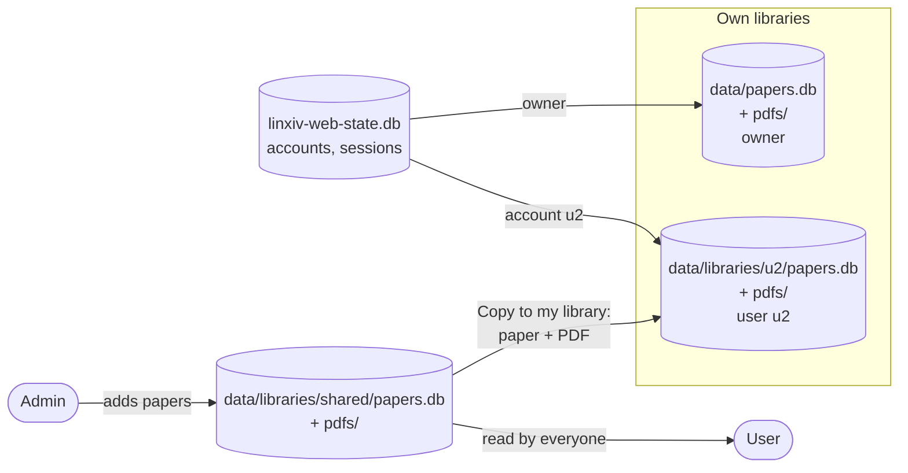
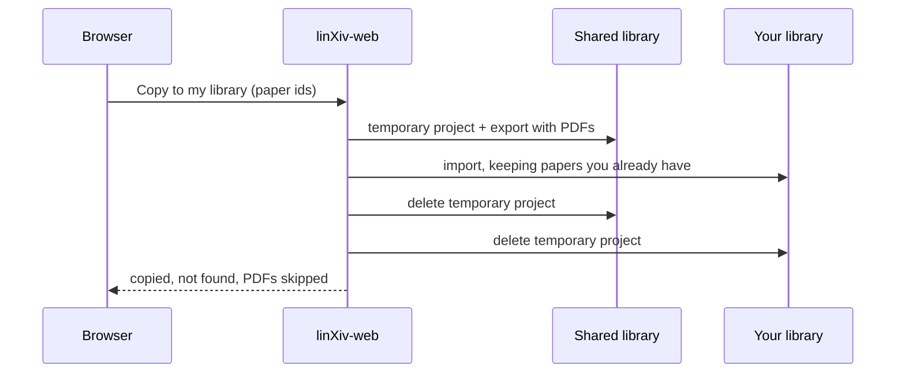

# Multi-user and accounts

The Server Admin pages cover what admins manage for the whole server: accounts and the shared library (this page), [where the data lives](data.md), [maintenance operations](maintenance.md), and [background jobs and MCP](jobs-mcp.md).

Out of the box linXiv-web has one password and one library. Multi-user mode adds named accounts, each with its own library, plus a shared library that everyone can read and only admins can change. It stays off until an admin turns it on, and turning it on leaves your existing library as it is.

## Multi-user mode

Open **Settings → Server Admin → Multi-user mode**, choose your username and click **Turn on**. You keep the server password (the one set in `.env` or during first-run setup), and your library stays your own. From then on the login page asks for a username and a password.

The account that turned the mode on is the server owner. It always stays an admin and can't be deleted.

Only the owner can turn the mode off. Everyone else is logged out at once, and afterwards only the owner can log in, with the password alone as before. Accounts, their libraries and the shared library are kept and come back when the mode is turned on again.

## Accounts

**Settings → Server Admin → Users** lists every account with its role, library and creation date. From there an admin can:

- add an account with a username, a password and a role (user or admin);
- rename an account or set a new password for it;
- change its role;
- delete it.

Usernames use lowercase letters, digits, dot, dash and underscore, up to 32 characters. Passwords need at least 8 characters, and no two accounts may share one, the owner's server password included.

A new password, a role change or a deletion logs that account out of every browser at once. The last admin can't be demoted or deleted, and nobody can delete their own account.

Deleting an account removes the login only. Its library stays on disk, and the panel shows the folder so you can keep, move or remove it yourself.

## What admins and users can do

| | User | Admin |
|---|---|---|
| Own library: add, edit, tag, projects, notes, PDFs | Yes | Yes |
| Own settings: AI keys, contacts, feeds, metadata lookup | Yes | Yes |
| Read the shared library and copy papers from it | Yes | Yes |
| Change the shared library | No | Yes |
| Change own password | Yes | Yes |
| Server Admin: multi-user mode and accounts | No | Yes |
| [Maintenance operations](maintenance.md) and server backups | No | Yes |
| Duplicates page: merge or dismiss in own library | Yes | Yes |
| App logs, activity log | No | Yes |
| Update check, health, disk space, diagnostics | No | Yes |
| MCP server and its token | No | Yes |
| Server-wide settings: log level, update check, `GHCR_TOKEN`, MCP | No | Yes |

Users don't see the settings cards and groups they can't use, and the server checks the role on every request.

## The shared library

The top of the sidebar switches between **My library** and **Shared library** (M and S when the sidebar is collapsed). The choice is remembered in each browser. In the shared library a banner says which one you are looking at.

Admins fill the shared library with the usual pages: Add Paper, Search, Upload and the Home feed all work on whichever library is shown.

For users the shared library is read only. They can browse and search it, open PDFs and export BibTeX. The buttons that would change it are hidden, and the server refuses those changes.

To keep a paper, select it in the Library and click **Copy to my library**, or use the same button on the paper page. The paper and its PDF land in your own library, and the shared copy stays where it is. If you already have the paper, your stored metadata is kept.

## How the databases relate

Accounts and libraries live in separate files. `linxiv-web-state.db` holds accounts and sessions, and each account points at one library. A library is an ordinary linXiv data folder with its own `papers.db`, settings and PDF folder.



Copy to my library goes through a project archive, the same way you would move a project by hand. The server puts the papers in a temporary project in the shared library, exports it with its PDFs, imports the archive into your library, and then deletes the temporary project on both sides. The papers themselves stay.



## Projects and reading lists

Projects and reading lists belong to one library, so accounts can't see each other's. An admin can create them in the shared library, where everyone can open them. Copying papers to your library leaves their project behind.

## Passwords

Change your own password in **Settings → Server & data → Login**. The owner's password is the server password: when it comes from `LINXIV_WEB_PASSWORD_HASH` or `LINXIV_WEB_PASSWORD`, change it in `.env`.

Admins set a new password for anyone in the Users panel. If nobody can log in, reset a password on the server, no restart needed:

```sh
# The owner (server password)
docker compose exec linxiv-web python -m app reset-password

# One account
docker compose exec linxiv-web python -m app reset-password --user alice
```

Either one logs that account out of every browser.
